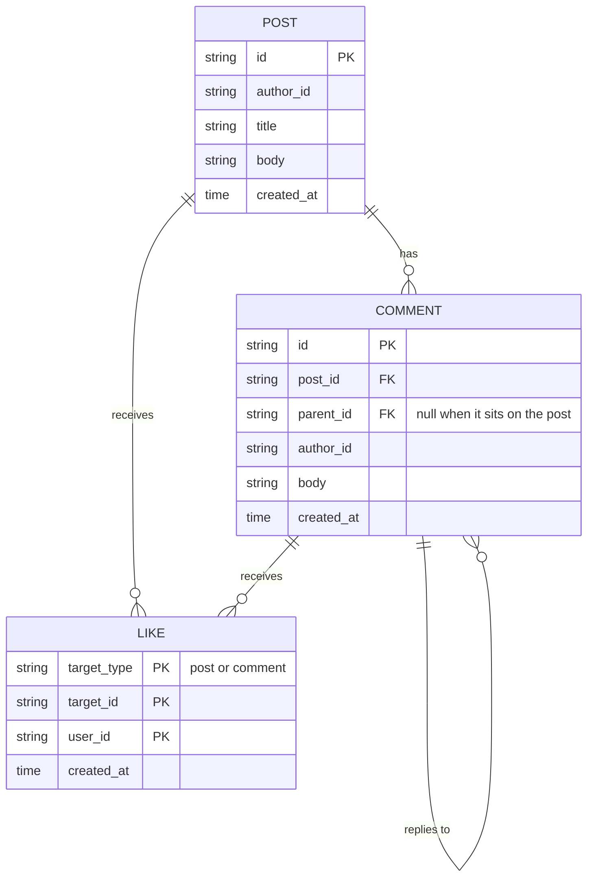

# Design notes

## Data model



### Comments are an adjacency list

A comment stores its parent, and the tree is assembled on read. Writes stay
O(1), depth costs nothing to store, and there is no derived structure that can
drift out of step.

The cost is that a subtree cannot be fetched without the thread around it. A
materialised path (`/c1/c7/c9`) or a closure table buys that back, and both ask
for bookkeeping on every write. Threads here are read whole or paged from the
top, so the adjacency list is the right trade until partial reads become a real
access pattern.

Both invariants a reply must satisfy are checked at write time: the parent
exists, and it belongs to the same post. Since a parent always exists before
its children, the comments form a forest by construction, and no read path has
to defend against cycles.

### Likes are a set

The key is `(target type, target id, user)`. "One like per user per item" is
then a property of the data rather than a rule someone has to remember to
enforce: a map of maps here, a composite primary key in Postgres. Carrying the
type in the key keeps a post and a comment that share an id apart.

One relation for both targets keeps the engagement summary to a single pass.

The alternative is to hang likes off the record they belong to, as a `liked_by`
collection on the post and on the comment. That reads well: the thread load
drops from three store calls to two, a count is the length of a field, and a
comment physically carries its own likes, so the aggregate cannot see a comment
without them.

It loses on writes, and on the invariant. Once-per-user is enforced here by the
key itself, which is a guarantee the storage engine makes and which survives
the move to Postgres unchanged. A `liked_by` collection turns each like into a
read-modify-write of the parent row: uniqueness moves into application code
where two concurrent likes can lose each other, and every like on a popular
post queues behind a lock on that one row instead of inserting independently.
The collection is also unbounded, so a post carries every liker into every read
of it, and a plain field like that cannot answer "what has this user liked"
without scanning everything.

Note that the requirement forces the shape. Enforcing once-per-user means
storing who liked, not how many, so the collection is unbounded and user-keyed
either way. That is a many-to-many between users and targets, and a
many-to-many belongs between the two sides rather than inside one of them. Were
a count all that was ever needed, a counter column would beat both.

The round trip is the real cost, and it is the cheap one to buy back: a
`like_count` maintained on the post and the comment alongside the likes
relation gives the read profile of the embedded version without giving up the
write path. That is the shape I would move to under load, and it is in Next
below.

Nothing is deleted, so there are no tombstones or cascades to reason about.

## Ordering, and why the id generator exists

Comment order is user-visible, and cursor paging assumes it. So ids are
generated to sort in creation order: a timestamp, then a counter, then random
bytes.

The counter is the part worth explaining. The system clock is microsecond
grained, but records can be written faster than that, so a tight loop produces
several records sharing one timestamp. With only random bytes after the
timestamp, their relative order would be decided by chance — comments in a busy
thread would come back shuffled. The counter makes ordering exact within a
process.

An id and its `created_at` come from the same clock reading. That is what makes
sorting by id identical to sorting by `(created_at, id)`, which is the
invariant the paging cursor rests on, and it is pinned by a test.

Ordering is exact within one process, which is what a single-writer store
needs. Across processes, records inside the same microsecond fall back to the
timestamp; a shared sequence or database-side ordering is the answer when that
starts to matter.

## API

### Likes are addressable, so PUT and DELETE

A like is identified by what it is on and who gave it, so it gets a URL:
`/v1/posts/{id}/likes/{user}`. Both verbs are idempotent, which is the storage
key restated in the protocol. A retry after a timeout still leaves one like,
and removing a like that was never given returns `204`.

### Creates take an Idempotency-Key

Likes are safe to retry by design; creates needed help. A caller may send
`Idempotency-Key`, and the key is bound to the new record's id inside the same
lock that stores it, so the check and the write are one step. Two concurrent
requests carrying one key resolve to one record, and exactly one caller is told
it created something.

A repeat returns the original record with `200` rather than `201`, because
nothing was created. Validation runs before the key is claimed, so a rejected
request leaves the key usable.

### Threads are paged by keyset

`GET /v1/posts/{id}` pages the top-level comments and brings each one's replies
with it. `limit` sets the page size, `cursor` continues from the previous page,
and `max_depth` bounds reply depth for a caller who wants a preview.

The cursor is the last id of the previous page. Keyset paging holds its place
while people keep commenting: no page repeats a comment or skips one, which
offset paging cannot promise on a thread that is actively growing.

Bounding breadth by default and depth on request follows where threads actually
grow. A busy post collects thousands of top-level comments; reply chains stay
in the double digits. So `limit` defaults to 20 and `max_depth` defaults to
unbounded, and a comment whose replies were trimmed still reports
`reply_count`.

Engagement takes no paging. It is an aggregate over the thread, and a partial
one answers a different question.

### One error shape

Every failure returns `{"error": {code, message, request_id}}`. The domain
returns `ErrNotFound` and `ValidationError`; only the transport knows which
status codes those become, which keeps HTTP out of the business rules.

Unknown JSON fields are rejected, so a caller sending `athor_id` hears about
the typo instead of creating a post with an empty author.

### Field limits count characters

A 200-character title is 200 characters in any language. Counting bytes would
cut a Cyrillic or emoji title off at roughly half, which makes the limit mean
something different depending on who is typing.

### URLs carry the version

Resource routes sit under `/v1`. It is visible in logs and in curl, and a
breaking change means mounting a v2 mux beside this one while clients move
over. Additive changes stay in v1, and clients are expected to ignore fields
they do not recognise.

Header or media-type versioning keeps a resource's URL stable across versions,
which is the better trade when that URL is an identifier other systems store.
That is not the case here.

## Structure

Three layers, each depending only on the one below.

```
cmd/server             configuration, storage choice, server lifecycle
internal/discussion    model, rules, Store interface
internal/store/memory  the Store implementation
internal/httpapi       HTTP, JSON, OpenAPI
```

The domain declares the `Store` interface it needs and knows nothing about who
implements it, so the storage decision lives in `main` and nowhere else. Every
method takes a `context.Context` the in-memory store ignores, so a SQL one can
honour cancellation without an interface change.

Building the tree, paging it, and summarising engagement are plain functions
over a loaded thread. That is where the logic worth getting wrong lives, and
keeping it apart from I/O means it is tested against a table of cases with no
store, no server and no clock.

## No router library

Routing is `net/http`'s method-and-wildcard mux: `GET /posts/{postID}` with
`r.PathValue`, and `405`s handled for free. Go 1.22 moved that into the
standard library, and it was most of what people reached for `chi` to get.

`chi` would still be a fair choice. It stays compatible with `http.Handler`, so
nothing structural would change, and its middleware package would replace the
request id, access log and panic recovery here — about 110 lines. Those stayed
because they are short, they do what this service needs, and they are covered
by tests. `gin` and `echo` go further and hand handlers their own context type,
a larger commitment than a service this size earns.

The result is an empty dependency list: `go run ./cmd/server` is the whole
setup, with no versions to keep current.

## Where the brief left room

- **Engaged users** are those who commented, replied, or liked. Writing the
  post is not an action on it, so the author counts only if they also did one
  of those. A thread nobody has touched reports zero.
- **Depth starts at 1** for a comment directly on the post. Levels with no
  comments are left out of `comments_by_depth`.
- **`longest_reply_chain` counts comments**, so one comment is a chain of 1 and
  an empty thread is 0.
- **Arbitrary depth is taken at face value.** The tree walk uses an explicit
  queue, and a test drives it to 100,000 levels. Nesting depth comes from the
  caller, and caller input should not reach the goroutine stack.

## Scope

In: the endpoints in the brief, keyset paging, idempotent writes, validation,
one error shape, request ids, graceful shutdown, an OpenAPI spec, and tests at
every layer.

Out, and why:

- **Authentication**, named as out of scope. With it, `author_id` and `userID`
  come from the token instead of the request, and the like routes shorten to
  `PUT /v1/posts/{id}/like`.
- **A real database.** The in-memory store sits behind the interface, so
  swapping it is one line in `main`. State lives as long as the process.
- **Metrics and tracing**, which mean dependencies. A single `go run` was worth
  more at this size.

Two things a reviewer should know. Reading a thread is three store calls rather
than one snapshot, so a comment written between the second and the third is
counted without its likes; in SQL those three become one read-only transaction.
And paging slices a forest built in full, which suits a store holding the
thread in memory — a SQL store would page the top-level comments first and seed
a recursive query with only those ids.

## Scaling to millions of users

The model holds; what changes is where state lives and what is computed on
read.

- **Stateless API, sharded by post.** App servers scale horizontally; state
  lives in Postgres sharded by `post_id`. A thread is the unit of access, so
  its tree, pages and engagement stay on one shard, and likes carry `post_id`
  to live with their thread.
- **Read only what the page needs.** Page top-level comments with an index
  range scan on `(post_id, id)`, fetch only their subtrees with a depth-bounded
  recursive CTE, and cache the first page of hot threads.
- **Maintain aggregates on write.** A comment stores its depth (its parent's
  plus one), so the depth histogram and longest chain update on insert.
  Distinct engaged users becomes a `(post_id, user_id)` table with a reference
  count, so unliking still takes a user out of the count.
- **Keep hot counters off the request path.** On a viral post the counter row
  becomes the bottleneck, so likes are still written exactly while the count is
  aggregated from a queue and converges within seconds.
- **Ids that order across instances.** The in-process counter orders only
  within one process; many instances need Snowflake-style ids with a node id,
  or ordering from the database. The cursor format does not change.
- **Shared idempotency keys, per-user rate limits.** Keys move to shared
  storage with a TTL, since a retry can land on any instance. Likes and
  comments are the obvious abuse vectors, so limits sit at the edge.

## Next

1. **Postgres behind the existing interface.** `parent_id` referencing
   `comments(id)`, a composite primary key on likes, and the thread read in one
   transaction. The engagement summary is one recursive CTE.
2. **Authentication**, which turns "one like per user" into something the
   server knows rather than something the caller asserts.
3. **A subtree endpoint**, `GET /v1/comments/{id}/replies`, so a caller who
   trimmed a thread with `max_depth` can pull one branch back on its own.
4. **Counters on the post** for likes and comments, so a busy thread is not
   recounted on every read.
5. **Metrics and tracing** through the context the store already takes.
