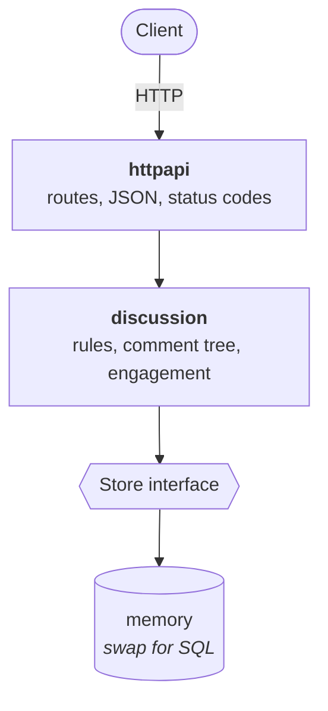

# Discussion service

An HTTP/JSON API for posts, comments nested to any depth, and likes.

Go 1.23+, standard library only.

## Run it

```
go run ./cmd/server
```

It listens on `:8080`. Use `-addr :9000` or `ADDR=:9000` to change that.

```
go test -race -cover ./...
```

`make run`, `make test` and `make lint` do the same.

## How it fits together



Each layer depends only on the one below it. The domain declares the `Store`
interface it needs, so storage is a choice made in `main` and nowhere else.

```
cmd/server             config, storage choice, server lifecycle
internal/discussion    model, rules, Store interface
internal/store/memory  the Store implementation
internal/httpapi       HTTP, JSON, OpenAPI spec
```

## API

Full spec: [internal/httpapi/openapi.yaml](internal/httpapi/openapi.yaml), also
served at `GET /openapi.yaml`.

| Method   | Path                                  | Description                        |
| -------- | ------------------------------------- | ---------------------------------- |
| `POST`   | `/v1/posts`                           | Create a post                      |
| `GET`    | `/v1/posts/{id}`                      | Post with a page of its comment tree |
| `GET`    | `/v1/posts/{id}/engagement`           | Engagement summary                 |
| `POST`   | `/v1/posts/{id}/comments`             | Comment on a post, or reply        |
| `PUT`    | `/v1/posts/{id}/likes/{userID}`       | Like a post                        |
| `DELETE` | `/v1/posts/{id}/likes/{userID}`       | Remove a like from a post          |
| `PUT`    | `/v1/comments/{id}/likes/{userID}`    | Like a comment                     |
| `DELETE` | `/v1/comments/{id}/likes/{userID}`    | Remove a like from a comment       |
| `GET`    | `/healthz`, `/openapi.yaml`           | Health check and spec              |

Resource routes sit under `/v1`. The health check and the spec describe the
service rather than a version of it, so they sit outside.

There is no authentication, so the acting user is passed in: `author_id` in the
body for writes, `userID` in the path for likes.

### Create a post

```bash
curl -sX POST localhost:8080/v1/posts \
  -H 'Content-Type: application/json' \
  -d '{"author_id":"alice","title":"Hello","body":"First post"}'
```

```json
{
  "id": "18d3a1e2543ee620…",
  "author_id": "alice",
  "title": "Hello",
  "body": "First post",
  "created_at": "2026-09-09T12:00:00Z"
}
```

Creates accept an optional `Idempotency-Key` header. Sending the same key again
returns the record made the first time, with `200` instead of `201`, so a retry
after a timeout cannot leave two posts behind.

### Comment, and reply to a comment

```bash
curl -sX POST localhost:8080/v1/posts/$POST_ID/comments \
  -H 'Content-Type: application/json' \
  -d '{"author_id":"bob","body":"Nice one"}'

curl -sX POST localhost:8080/v1/posts/$POST_ID/comments \
  -H 'Content-Type: application/json' \
  -d '{"author_id":"carol","body":"Agreed","parent_id":"'$COMMENT_ID'"}'
```

Leave `parent_id` out to comment on the post, set it to reply to a comment.
Replies nest to any depth. The parent has to be on the same post.

### Like and unlike

```bash
curl -sX PUT    localhost:8080/v1/posts/$POST_ID/likes/bob
curl -sX DELETE localhost:8080/v1/posts/$POST_ID/likes/bob
curl -sX PUT    localhost:8080/v1/comments/$COMMENT_ID/likes/bob
```

Both return `204`. A user's like on an item either exists or it does not, so
repeating either call lands in the same place.

### Read a thread

`GET /v1/posts/{id}` returns the post, its like count, and a page of the
comment tree with replies oldest first:

```json
{
  "id": "18d3a1e2543ee620…",
  "author_id": "alice",
  "title": "Hello",
  "body": "First post",
  "created_at": "2026-09-09T12:00:00Z",
  "likes": 2,
  "comments": [
    {
      "id": "18d3a1e255f97ed0…",
      "post_id": "18d3a1e2543ee620…",
      "parent_id": null,
      "author_id": "bob",
      "body": "Nice one",
      "created_at": "2026-09-09T12:00:05Z",
      "likes": 1,
      "reply_count": 1,
      "replies": [
        {
          "id": "18d3a1e2570cd330…",
          "post_id": "18d3a1e2543ee620…",
          "parent_id": "18d3a1e255f97ed0…",
          "author_id": "carol",
          "body": "Agreed",
          "created_at": "2026-09-09T12:00:09Z",
          "likes": 0,
          "reply_count": 0,
          "replies": []
        }
      ]
    }
  ],
  "comments_page": {
    "limit": 20,
    "next_cursor": "18d3a1e255f97ed0…",
    "has_more": true,
    "total_top_level_comments": 42
  }
}
```

### Paging a thread

Top-level comments are paged; each one arrives with its replies.

| Parameter   | Default | Meaning                                                     |
| ----------- | ------- | ----------------------------------------------------------- |
| `limit`     | 20      | Top-level comments per page, up to 100.                      |
| `cursor`    | —       | `next_cursor` from the previous page. Opaque.                |
| `max_depth` | 0       | How deep to include replies. 0 includes them all.            |

```bash
curl -s "localhost:8080/v1/posts/$POST_ID?limit=20"
curl -s "localhost:8080/v1/posts/$POST_ID?limit=20&cursor=$NEXT_CURSOR"
```

Read `comments_page.next_cursor` and stop when `has_more` is false. Ids sort in
creation order, so the cursor is a keyset: it holds its place while comments
are being added, and never repeats or skips one.

`max_depth` bounds a reply chain for callers that want a preview. A comment
whose replies were left out still reports `reply_count`, so a client can see
there is more below and ask again without the limit.

Engagement is an aggregate over the whole thread, so it takes no paging.

### Engagement

`GET /v1/posts/{id}/engagement`:

```json
{
  "post_id": "18d3a1e2543ee620…",
  "post_likes": 2,
  "comment_likes": 3,
  "comment_count": 5,
  "distinct_engaged_users": 4,
  "comments_by_depth": { "1": 2, "2": 2, "3": 1 },
  "longest_reply_chain": 3
}
```

- `comment_likes` — likes across every comment in the thread.
- `distinct_engaged_users` — users who commented, replied, or liked anything in
  the thread. Writing the post is not an action on it, so the author counts
  only if they also did one of those.
- `comments_by_depth` — comments per nesting level. A direct comment on the
  post is level 1. Empty levels are left out.
- `longest_reply_chain` — comments on the longest path from a top-level comment
  down to a leaf.

## Errors

One shape, whatever went wrong:

```json
{
  "error": {
    "code": "not_found",
    "message": "post \"nope\": not found",
    "request_id": "8f14e45fceea167a"
  }
}
```

Codes: `invalid_argument`, `invalid_json`, `not_found`, `payload_too_large`,
`unsupported_media_type`, `internal`.

Every response carries an `X-Request-Id`, reused from the request when the
caller sends one, so a call can be followed through the logs.

---

[DECISIONS.md](DECISIONS.md) covers the data model and the reasoning.
